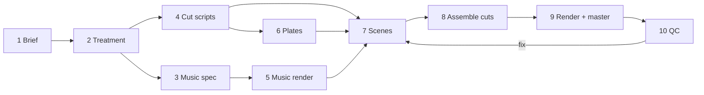

# Workflow: from brief to finished ad

This is the production line for the TinaCMS ads.
Run it again for a new campaign, a new feature, or a new language.
Every step writes a file that the next step reads, so each step can be redone alone.



## 1. Brief

Collect the facts before any idea: brand colours, fonts, logo files, the mascot rules, the current messaging, the proof points, and the ad-platform rules.
Output: `docs/marketing-brief.md`.
Check every number on the day you render (GitHub stars change).

## 2. Treatment

Decide the one idea, the campaign line, the call to action, the style bible (palette, type, motifs, motion) and the list of cuts.
Output: `docs/treatment.md`.
The treatment is the contract: scenes may improve on it, but they keep its motifs and rules.

## 3. Music spec

Fix the tempo (120 BPM, so a beat is 30 frames at 60 fps), the structure of every cue, and the hard cue points the picture will hit (impacts, drops, stops, the sonic logo).
Output: `docs/music-spec.md`.

## 4. Cut scripts (scene by scene)

For each cut, write a table of scenes with times, bars, on-screen words and the handoff between scenes, then a short beat-by-beat description per scene.
Outputs: `docs/cuts/anthem.md`, `docs/cuts/cutdowns.md`.
Rules: 2 to 5 words per card, at least 1.5 s on screen; the brand inside 5 s; one call to action, at least 4 s.

## 5. Music render

The soundtrack is synthesized from code (no samples, no AI music, no voice), so TinaCMS owns it outright and no Content ID claim can hit an ad.

```bash
cd music && uv sync && uv run python src/render.py
```

Outputs per cue in `music/out/`: `<cue>.wav`, `<cue>.timing.json` (every hit, in seconds), `<cue>.envelopes.json` (per-frame levels), `<cue>.overview.png`.
Picture-sync sounds (clicks, typing, pops, pings) live in `music/cues/<cue>.foley.json`. Edit them to match the picture, then render again.

## 6. Plates (real UI)

A real TinaCMS site runs locally in `plates/site`.
Playwright captures the real visual editor (hover outlines, forms, the typing sequence, the media manager, the block picker) with element boxes.
Outputs: `plates/out/*.png|webp` + `*.boxes.json` + `manifest.json`. See `plates/README.md`.

## 7. Scenes

One folder per scene in `mv/src/scenes/<id>/`.
A scene builds its DOM once and then draws each frame as a pure function of time (see `docs/engine.md`).
Build and check a scene in a work cut (`mv/src/cuts/wip-<id>.ts`):

```bash
cd mv
node render/sheet.mjs --cut wip-<id> --from 0 --to 8 --step 0.25 --cols 6 --cell 400 --out /tmp/sheet.jpg
node render/sheet.mjs --cut wip-<id> --from 1.8 --to 2.2 --step 0.0167 --cols 12 --cell 200 --out /tmp/move.jpg
```

Look at every sheet. Do at least 3 polish passes per scene.

## 8. Assemble cuts

A cut is a timeline of scenes with props: `mv/src/cuts/<cut>.ts`.
The same scene appears in several cuts with different lengths and props, and lays out for 16:9 and 9:16.

## 9. Render and master

```bash
cd mv
node render/render.mjs --cut anthem          # ProRes master, 60 fps: out/anthem.mov
node render/master.mjs --cut anthem          # + music: out/deliver/anthem.mp4 and a preview
node render/all.mjs                          # every cut, then every master
```

## 10. QC

For every cut, before it ships:
- Play it end to end with sound, then once muted. Muted, does the story still read?
- The logo is on screen inside 5 s; the call to action holds at least 4 s; there is one call to action.
- Every number is current (stars), every claim is true, and no third-party logo or quote is on screen.
- Text is inside the safe area (9:16: top 14%, bottom 35%, sides 6%).
- Scrub every cut point frame by frame: no pops, no 1-frame flashes that are not on purpose.
- Audio: about -14 LUFS, true peak at or below -1 dBTP, the hits land on the picture.
- Upload one cut privately to YouTube and check it gets no Content ID claim.
